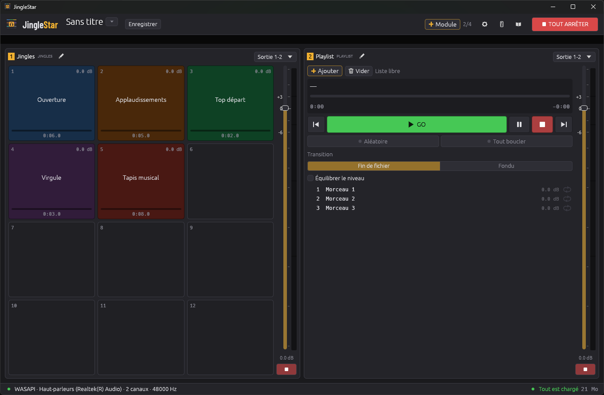
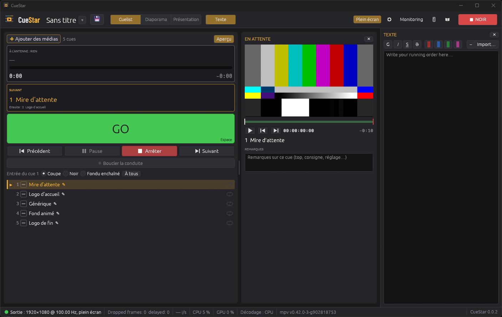
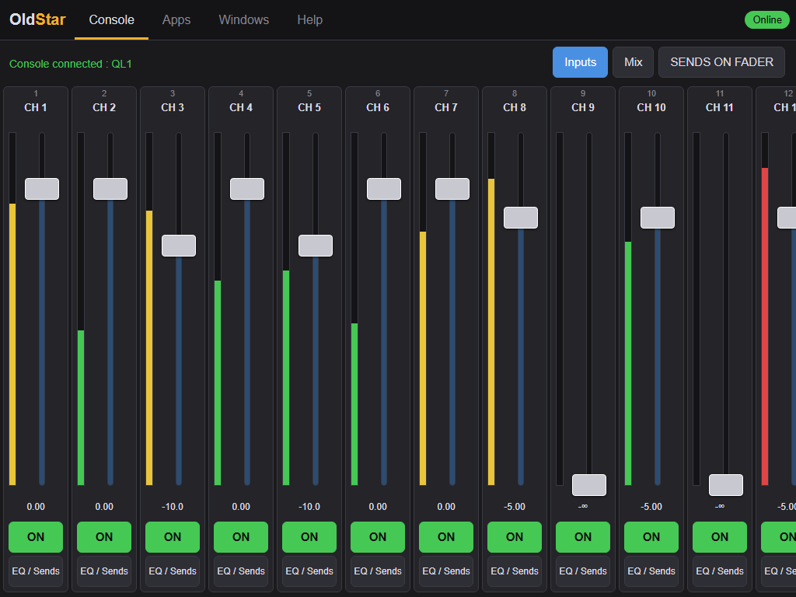

# MediaStar

**Des applications gratuites pour la régie : sons, vidéos, télécommande et mesure
acoustique.** Simples, légères, pour Windows, macOS et Linux.

- **Simple** : une interface sombre et lisible, un gros bouton GO, Échap pour tout arrêter,
  une aide intégrée (**F1**) en français et en anglais.
- **Léger** : démarre vite, rien d'autre à installer.
- **Multiplateforme** : Windows, macOS (Intel et Apple Silicon) et Linux.
- **Gratuit** : code source public, licence MIT.
- **Pilotable** : OSC, MIDI, consoles Yamaha et Midas, Stream Deck.
- **Rien ne se perd** : la session est gardée et revient au lancement suivant.

## Les applications

### JingleStar : jingles et playlists

Jusqu'à 4 modules : boutons de jingles, playlist, conduite lancée au GO ou texte libre. Boucles,
fondus, égaliseur, niveau des morceaux équilibré, une paire de sorties par module.

Aide : [français](apps/jinglestar/docs/aide.md) · [English](apps/jinglestar/docs/help.md)

### CueStar : vidéo sur écran de sortie

Vidéos, images et sons sur un vidéoprojecteur ou un écran de scène : conduite au GO, diaporama
et présentation PDF. Bouton **NOIR** toujours à portée.

Aide : [français](apps/cuestar/docs/aide.md) · [English](apps/cuestar/docs/help.md)

### OldStar : une vieille tablette en télécommande

La tablette ouvre une page dans son navigateur, sans rien installer : console Yamaha CL/QL ou
Midas M32, boutons de CueStar et JingleStar, fenêtres du PC, micros HF Sennheiser et Shure.

Aide : [français](apps/oldstar/docs/aide.md) · [English](apps/oldstar/docs/help.md)

### SweepStar : mesure acoustique

Réponse en fréquence, réponse impulsionnelle, délai en ms et en mètres, transfert en direct,
RTA et générateur de bruit.

Aide : [français](apps/sweepstar/docs/aide.md) · [English](apps/sweepstar/docs/help.md)

### MediaStar : tout en un

Les quatre applis dans un seul programme. JingleStar et CueStar existent aussi seules.

## Compatibilité

| Système | Versions |
| --- | --- |
| Windows | 10 et 11, 64 bits |
| macOS | 11 Big Sur et plus récent, Mac Intel et Apple Silicon (M1, M2…) |
| Linux | 64 bits (x86_64), Ubuntu 22.04 ou équivalent et plus récent |
| Tablette OldStar | iOS 9 et plus, Android 4.4 et plus |

## Télécharger et installer

Tout est sur la page [**Releases**](https://github.com/acetayls/MediaStar/releases).

- **Windows** : l'installeur `…-setup.exe`, ou le `.zip` portable.
- **macOS** : le `.dmg` de votre Mac (`intel` ou `apple-silicon`), puis glisser l'appli dans
  Applications. L'appli n'est pas encore notarisée par Apple : la première fois, **clic droit →
  Ouvrir**. Sous macOS 15, si ce n'est pas proposé : **Réglages Système → Confidentialité et
  sécurité → Ouvrir quand même**. Le `.dmg` contient un LISEZ-MOI.
- **Linux** : l'`.AppImage`, à rendre exécutable (`chmod +x`) puis à lancer.

## Stream Deck (Bitfocus Companion)

1. Dans la release MediaStar, télécharger `MediaStar-Companion-<version>.tgz`.
2. Dans Companion, page **Modules** : **Import module package**, choisir le `.tgz`.
3. Page **Connections** : ajouter **MediaStar**, choisir JingleStar ou CueStar et l'adresse IP
   du PC (`127.0.0.1` si c'est le même).
4. Dans l'appli, **Télécommandes → OSC** : OSC et OSCQuery activés.
5. Glisser les presets sur les touches du Stream Deck.

## Développeurs

Compilation et structure du dépôt : [docs/DEVELOPPEMENT.md](docs/DEVELOPPEMENT.md).
