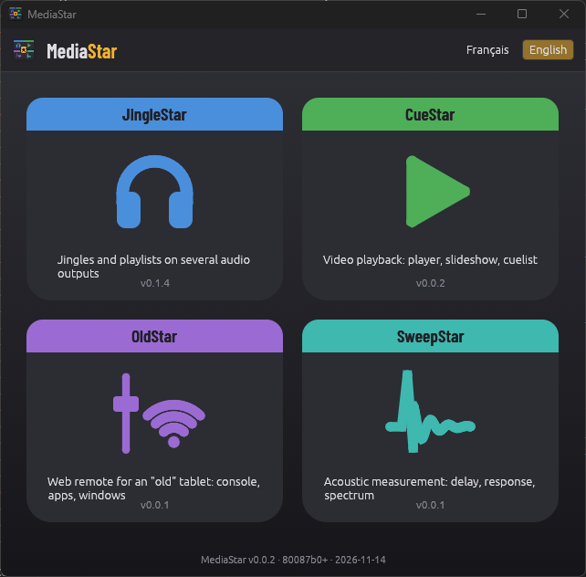
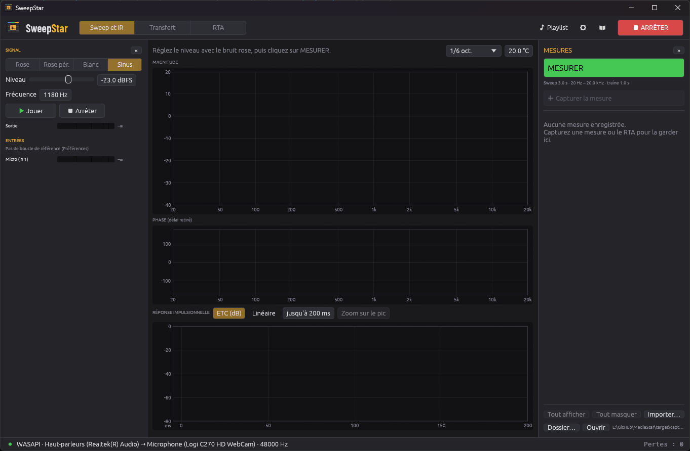

# MediaStar

**Une suite d'applications gratuites pour la régie de spectacle, d'événement et de salle :
sons, vidéos, télécommande et mesure acoustique.** Simples à prendre en main, légères, et
identiques sous Windows, macOS et Linux.

<!-- Capture : docs/captures/mediastar.png (accueil MediaStar avec les quatre tuiles) -->
<!--  -->

| Appli | Pour quoi faire |
| --- | --- |
| **JingleStar** | Lancer des jingles, des playlists et une conduite sonore |
| **CueStar** | Envoyer vidéos, images, diaporamas et PDF sur un écran de sortie |
| **OldStar** | Faire d'une vieille tablette une télécommande, sans rien installer dessus |
| **SweepStar** | Mesurer et caler une sonorisation (sweep, délai, RTA, transfert) |
| **MediaStar** | Les quatre dans un seul programme, avec un accueil pour lancer chacune |

## Pourquoi MediaStar

- **Simple** : une interface sombre, lisible en régie, avec un gros bouton GO, Échap pour tout
  arrêter et une aide intégrée (touche **F1**) en français et en anglais.
- **Léger** : un petit programme qui démarre vite ; le lecteur vidéo et MediaInfo sont inclus
  dans les paquets, il n'y a rien d'autre à installer.
- **Multiplateforme** : Windows, macOS (Intel et Apple Silicon) et Linux.
- **Gratuit et ouvert** : code source public, licence MIT.
- **Pilotable** : OSC avec OSCQuery, MIDI, consoles Yamaha (QL, CL, TF…) et Midas M32 /
  Behringer X32, Bitfocus Companion et Stream Deck.
- **Sans perte de travail** : la session est gardée automatiquement et se retrouve au
  lancement suivant.

## Les applications

### JingleStar : jingles et playlists

<!-- Capture : docs/captures/jinglestar.png (deux ou trois modules : Jingles, Playlist, Cuelist) -->
<!--  -->

Un lecteur de jingles et de playlists multi-sorties.

- Jusqu'à 4 modules, chacun en **Jingles** (12 boutons), **Playlist**, **Cuelist** (conduite
  lancée au GO) ou **Texte** (la conduite écrite), avec son volume et son vu-mètre.
- Chaque jingle : une fois ou en boucle, points de début et de fin, fondus, égaliseur, sur une
  forme d'onde zoomable.
- Playlists avec enchaînement sans blanc ou fondu enchaîné, aléatoire, et **équilibrage du
  niveau** des morceaux (LUFS, crête, crête vraie ou RMS) sans toucher aux fichiers.
- Chaque module sur sa paire de sorties (1-2, 3-4…) avec une carte son multicanal.
- Formats : WAV, AIFF, MP3, FLAC, OGG/Vorbis, AAC/M4A.

Aide : [français](apps/jinglestar/docs/aide.md) · [English](apps/jinglestar/docs/help.md)

### CueStar : vidéo sur écran de sortie

<!-- Capture : docs/captures/cuestar.png (Cuelist avec quelques cues et l'aperçu) -->
<!--  -->

Envoie des vidéos, des images et des sons sur un vidéoprojecteur, un écran de scène ou une
régie vidéo. La sortie tourne dans un programme à part : une régie qui rame ne retarde aucune
image.

- **Cuelist** : une conduite de médias lancés au GO, qui peuvent s'enchaîner tout seuls ;
  réglages par cue (rotation, entrée, sortie, fondus, volume, égaliseur).
- **Diaporama** : un dossier de photos et de vidéos.
- **Présentation** : un PDF, affiché à la résolution de la sortie (un PowerPoint s'exporte en
  PDF).
- **NOIR** ou Échap coupe l'image à tout moment.
- Formats : MP4, MOV, MKV, AVI, WebM, MXF, MPEG, TS, WMV…, images JPEG, PNG, BMP, GIF, TIFF,
  WebP, et sons.

Aide : [français](apps/cuestar/docs/aide.md) · [English](apps/cuestar/docs/help.md)

### OldStar : la vieille tablette devient télécommande

<!-- Capture : docs/captures/oldstar.png (la page sur une tablette, et la fenêtre du PC avec le QR code) -->
<!--  -->

Le PC sert une page web sur le réseau local ; la tablette ou le téléphone l'ouvre dans son
navigateur, même ancien (iOS 9, Android 4.4). On scanne le QR code affiché sur le PC, et
c'est tout.

- Pilote une console **Yamaha CL/QL** ou **Midas M32 / Behringer X32** (faders, EQ, envois),
  les boutons de **CueStar** et de **JingleStar**, et des **fenêtres du PC** qu'on voit et
  qu'on touche (Lake Controller par exemple).
- Suivi des **micros HF** Sennheiser (EM 300/500 G3, EM 2000/2050) et Shure (Axient Digital
  AD4D, AD4Q) : pile, HF, niveau et alertes.
- La console est facultative.

Aide : [français](apps/oldstar/docs/aide.md) · [English](apps/oldstar/docs/help.md)

### SweepStar : mesure acoustique

<!-- Capture : docs/captures/sweepstar.png (mesure par sweep avec le panneau Mesures, ou le RTA) -->
<!--  -->

Pour caler une sonorisation avec un micro de mesure et une carte son.

- **Sweep** : réponse en fréquence, phase, réponse impulsionnelle et **délai** en
  millisecondes et en mètres, avec ou sans boucle de référence.
- **Transfert en direct** avec n'importe quel signal, et recherche du délai.
- **RTA** de 1/1 à 1/48 d'octave, pondérations A, C, Z, et dB SPL après calibration.
- Générateur de bruit rose, blanc et sinus, et playlist de soundcheck.
- Mesures gardées, superposables, exportables en WAV et pour REW.

Aide : [français](apps/sweepstar/docs/aide.md) · [English](apps/sweepstar/docs/help.md)

### MediaStar : tout en un

Un seul programme qui regroupe les quatre applis. L'accueil lance chacune dans sa propre
fenêtre ; on peut en ouvrir plusieurs en même temps (JingleStar et CueStar, par exemple).
JingleStar et CueStar existent aussi en programmes séparés, chacun avec son numéro de version.

## Télécharger

Tout se trouve sur la page [**Releases**](https://github.com/acetayls/MediaStar/releases) :
une release par appli et par version (`mediastar-v…`, `jinglestar-v…`, `cuestar-v…`).
OldStar et SweepStar sont livrées dans MediaStar.

| Système | Fichier à prendre |
| --- | --- |
| Windows | `…-windows-x64-setup.exe` (installeur) ou le `.zip` portable ; JingleStar : un seul `.exe` à lancer |
| Mac Apple Silicon (M1, M2…) | `…-macos-apple-silicon.dmg` |
| Mac Intel | `…-macos-intel.dmg` |
| Linux | `….AppImage` (MediaStar, CueStar) ou `.tar.gz` (JingleStar) |

## Installer

### Windows

Lancer l'installeur, ou dézipper la version portable et lancer l'exe. Au premier lancement
d'OldStar, Windows demande d'autoriser le pare-feu : acceptez, sinon les tablettes ne pourront
pas joindre le PC.

### macOS

1. Ouvrir le `.dmg` et glisser l'appli dans **Applications**.
2. L'appli n'est pas encore notarisée par Apple : au premier lancement, **clic droit sur
   l'appli → Ouvrir → Ouvrir**. Sous macOS 15 (Sequoia), si ce n'est pas proposé : essayer de
   l'ouvrir une fois, puis **Réglages Système → Confidentialité et sécurité → Ouvrir quand
   même**.
3. Si macOS refuse encore, dans le Terminal :

   ```sh
   xattr -dr com.apple.quarantine /Applications/MediaStar.app
   ```

Le `.dmg` contient un LISEZ-MOI qui reprend ces étapes. SweepStar demande l'accès au micro.

### Linux

Rendre l'AppImage exécutable puis la lancer :

```sh
chmod +x MediaStar-*-linux-x86_64.AppImage
./MediaStar-*-linux-x86_64.AppImage
```

## Pour les développeurs

Compilation, structure du dépôt et publication des versions :
[docs/DEVELOPPEMENT.md](docs/DEVELOPPEMENT.md). En bref :

```sh
cargo run --release -p mediastar
```

Licence MIT.
